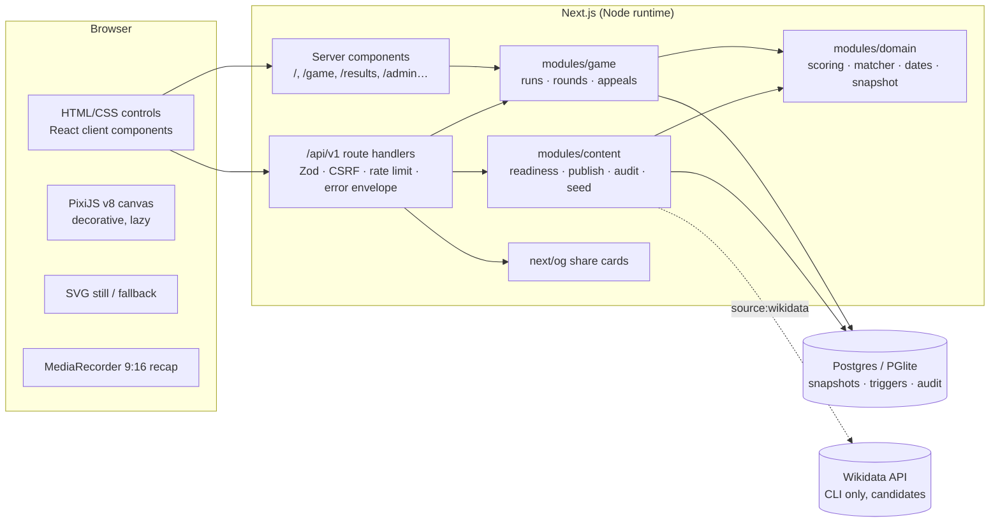

# WARTRACE — Implementation Decisions

**Milestone:** MVCP vertical slice (master prompt stages A–F at foundation depth) · **Branch:** `cursor/mvcp-foundation-9189` · **Date:** 2026-11-22
**Disposition:** PLAYABLE DEMO · **NOT LAUNCH READY** · **CONTENT BLOCKED**

## 1. Resolved versions (pinned exactly in `package-lock.json`)

| Area | Choice | Version | Notes |
|---|---|---|---|
| Runtime | Node.js | ≥ 22.12 (tested 22.23) | `engines` enforced |
| Framework | Next.js App Router | 16.4.6 | Route Handlers for `/api/v1`, server components for pages |
| UI | React / React DOM | 19.3.1 | |
| Language | TypeScript | 6.0.3 | 7.x (native port) skipped: ecosystem tooling (eslint-config-next, tsx) not yet validated against it |
| Database | Postgres via Drizzle ORM | drizzle-orm 0.45.4, drizzle-kit 0.31.11 | Migrations in `drizzle/`; `0001_immutability.sql` is hand-written |
| Local DB | PGlite (Postgres 17 in WASM) | 0.5.17 | Used when `DATABASE_URL` is unset — see ADR-001 |
| Server DB driver | node-postgres | 8.23.1 | |
| Validation | Zod | 4.6.7 | Env, API bodies, analytics events, asset register, adapters |
| Renderer | PixiJS | 8.23.0 | Lazy-loaded; `pixi.js/unsafe-eval` shim because CSP forbids `unsafe-eval` |
| Tests | Vitest / Playwright / axe-core | 5.1.1 / 1.65.1 / 4.14.0 | |
| Lint | ESLint 9 + eslint-config-next | 9.39.5 / 16.4.6 | Flat config, includes React Compiler hook rules |

`npm audit --omit=dev`: 0 vulnerabilities. `npm audit` (all): 4 moderate in a dev-only `esbuild` pulled in by `drizzle-kit` (dev server CORS advisory GHSA-67mh-4wv8-2f99); not shipped, tracked in the risk register.

## 2. Task graph (as executed)

```
A Foundation ──► B Core engine ──► C Signature world ──► E Viral mechanics ──► F Reliability
     │                 │                  │                     ▲                  ▲
     └─► env/secrets   └─► publish gate ──┴─► D Content & evidence (gate, admin, Wikidata adapter)
```

| Stage | Delivered | Evidence |
|---|---|---|
| A | Next.js scaffold, tokens from `assets/style_tokens.json`, env validation (`src/server/env.ts`), Drizzle schema + migrations, guest cookies, CI workflow | `npm run lint/typecheck/build`, `.github/workflows/ci.yml` |
| B | NY date selection with DST, publish/freeze, matcher, scorer, run/round state machine, idempotency, seed | `tests/unit/*`, `tests/integration/game.test.ts` |
| C | Six-layer procedural scene in Pixi + SVG fallback, courier, landmarks, fog/dust, reduced motion, responsive layouts | `src/game/*`, `tests/e2e/responsive.spec.ts`, screenshots |
| D | Readiness gate, admin suite with roles, append-only audit, Wikidata adapter (live, tier C candidates), demo/verified content classes | `tests/integration/publish.test.ts`, `tests/unit/wikidata.test.ts` |
| E | Results (owner ledger / spoiler-safe public), 1:1 + OG cards, challenge links, client 9:16 WebM recap with card fallback, analytics contract | `tests/e2e/game.spec.ts` |
| F | E2E (mobile/desktop), axe, security suite, Postgres concurrency check, docs/runbook | `docs/RELEASE_REPORT.md` |

## 3. Architecture



Trust boundaries: the browser receives only opened prompts, its own locked results and source cards after lock. Answer banks, aliases and rarity live in the server-only `operation_snapshots` table and are read exclusively by `submitRound`/`buildRunView`.

### Key invariants and where they are enforced
| Invariant | Enforcement |
|---|---|
| Scores frozen per published version | Snapshot built at publish, sha256 over canonical JSON; DB trigger blocks snapshot updates; grading reads only the snapshot |
| One answer per round | `UPDATE … WHERE locked_at IS NULL` inside a transaction holding `SELECT … FOR UPDATE` on the run; locked-round DB trigger |
| Idempotent submit | Same key replays stored result; different key on locked round → 409 `ROUND_LOCKED` |
| Server-owned timer | Deadline persisted once at open; late submit → `timed_out`; overdue rounds expire lazily on next read |
| Published content immutable | Triggers on `daily_operations`, `operation_questions`, question entities/aliases once published; append-only audit |
| Demo never masquerades as verified | `content_class`; production env refuses demo publish and demo serving; banner on every demo surface |
| Release at 00:00 America/New_York | `dateKeyFor` via `Intl` with DST tests (T-001–T-003) |

## 4. Deviations and change log (justified)

| # | Deviation from handoff | Why | ADR |
|---|---|---|---|
| 1 | PGlite for local/test instead of a Postgres container | No Docker in the build environment; same SQL/migrations/triggers; real Postgres verified separately and in CI | ADR-001 |
| 2 | At most one non-locking clarification per round (ambiguous alias or spelling suggestion) | Prevents using suggestions as an answer oracle while honouring "never autocorrect without confirmation" | ADR-002 |
| 3 | `content_class` demo/verified on operations | Lets the full loop be demonstrated without ever presenting candidate content as verified | ADR-003 |
| 4 | Procedural code-drawn art as labelled demo placeholder | No commissioned art or licensed media available; addendum permits coherent labelled demo art | ADR-004 |
| 5 | Production rules keyed on `WARTRACE_DEPLOY_ENV`, not `NODE_ENV` | `next start` (NODE_ENV=production) is used for local e2e; deployment class is a separate concern | ADR-005 |
| 6 | In-memory token-bucket rate limiting | Single instance only; no Redis until required (master prompt). Must move to a shared store before multi-instance hosting | ADR-006 |
| 7 | Added columns beyond `db/reference-schema.sql` | `operation_snapshots`, `content_class`, `is_demo`, clarification fields, appeal explanation — see `src/modules/db/schema.ts` | — |
| 8 | Tier C (Wikidata/Wikipedia) cannot satisfy publication | Doc 04 marks C as discovery only; gate requires a reviewed tier A/B source per answer | — |

## 5. Threat and risk register

| ID | Threat / risk | Likelihood | Impact | Mitigation in this build | Residual / owner action |
|---|---|---|---|---|---|
| R1 | Answer-bank leak via API | Med | High | Snapshot server-only; views expose opened prompt + own locked entity; tests T-046 and e2e grep for rarity/aliases | Review any new endpoint against T-046 |
| R2 | Score forgery / double submit | Med | High | Server grading, persisted deadline, row lock, idempotency, triggers; 25-way Postgres race → exactly one lock | — |
| R3 | Guest/admin cookie forgery | Low | High | HMAC-signed values, DB stores sha256 of guest secret, admin role re-read per request, 8 h admin expiry | Rotate secrets on incident |
| R4 | CSRF on mutations | Med | High | Origin / Sec-Fetch-Site checks; strict mode for admin; SameSite=strict admin cookie | — |
| R5 | XSS via appeals / answers | Med | Med | Plain-text storage, React escaping only, http(s)-only evidence links, CSP (`script-src 'self'`) | Moderation before any public display |
| R6 | Mock admin auth reaching production | Low | Critical | Env validation rejects `development_mock_only` in production; login route refuses outside `local` | Owner must choose an identity provider |
| R7 | Rate-limit bypass across instances | Med | Med | Per-process buckets | Shared store (e.g. Postgres or Redis) before scaling out |
| R8 | Unreviewed history published as fact | Med | High | Readiness gate, tier rules, independent reviewer check, demo class + banner | Historian review of all launch content |
| R9 | Unlicensed media / fonts shipped | Low | High | Asset register with hashes; `assets:lint --production` fails until approval; fonts OFL candidates | Rights reviewer sign-off; archive OFL notices |
| R10 | Trademark conflict on "WARTRACE" | Unknown | High | Labelled working title in UI and terms | Clearance before launch |
| R11 | Analytics capturing PII / answers | Low | High | Strict enum/number schemas; disabled by default; no third parties | Consent design if a provider is added |
| R12 | Dev dependency advisory (esbuild via drizzle-kit) | Low | Low | Dev-only, not bundled | Track drizzle-kit upgrade |
| R13 | PGlite single-writer surprises in local dev | Med | Low | Documented; scripts and dev server should not run concurrently | — |
| R14 | Sensitive historical framing | Med | Med | Non-combat courier, no casualties/weapons/insignia, respectful copy | Editorial review |

## 6. Deployment procedure (not executed — requires owner authorization)

1. **Provision** managed Postgres ≥ 15 (separate preview and production databases) and a Node 22 host that supports Next.js 16 (e.g. a container platform or a Next.js host). Do not create accounts or spend without approval.
2. **Configure env** (host secret store, never the repo): `WARTRACE_DEPLOY_ENV`, `DATABASE_URL`, `GUEST_COOKIE_SIGNING_SECRET` and `ADMIN_AUTH_SECRET` (`openssl rand -base64 48`), `NEXT_PUBLIC_BASE_URL`, `GAME_TIME_ZONE=America/New_York`, `GAME_DEV_FIXTURE_MODE=false` in production, a real admin identity provider (not yet implemented — blocker).
3. **Migrate** as a release step: `npm ci && npm run db:migrate` against the target DB (never on app boot for managed Postgres).
4. **Content**: publish through `/admin` with a publisher account; confirm with `npm run content:verify -- --date YYYY-MM-DD`. Keep ≥ 14 verified days queued before broad launch.
5. **Build & ship**: `npm run build && npm start` behind TLS. Preview first; run the e2e suite against preview.
6. **Rollback**: application — redeploy the previous build; content — `/admin` → operation → *Restore this version* (audited) or *Disable* to take a day offline. Published rows and snapshots are immutable, so restore always targets a previously frozen version.

### Daily release runbook
- New operations become live at 00:00 America/New_York purely by date key — no cron required. Verify tomorrow's operation is published and `content:verify` passes before 23:00 ET.
- Incident: disable the operation (reason required), fix content as a new version, publish, verify checksum; never edit published rows.
- Appeals: triage daily in `/admin/appeals`; accepted corrections apply to future versions only.

## 7. Remaining work for later milestones
See `docs/RELEASE_REPORT.md` §9 for the prioritised punch list (P0 launch blockers, P1 addendum work such as the content calendar, rights/creative queues, social drafts, atlas pipeline and image regression, and P2 growth features).
